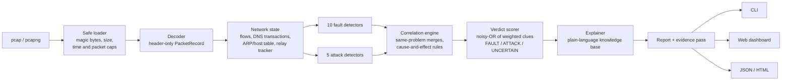

# PacketDoctor

**Finds the faults and attacks hidden in a packet capture, tells you which is which, and explains each one in plain language with the likely cause, a fix and the exact packets as evidence.**

> Network track: *Diagnosing Network Problems from Packet Captures*. Cybersecurity Hackathon, IIITDM Kancheepuram, 31 Oct to 1 Nov 2026.

**Live demo:** https://cybersec-hackathon-nna4.onrender.com/

**Demo video:** https://drive.google.com/drive/folders/1683sy8nyZZu2u0XiArt7F_M8CqQIWJRz?usp=sharing

---

## The problem

Small offices, labs and campus departments rarely have a network engineer. When "the network is broken", someone has to open a capture in Wireshark and read thousands of lines. That takes deep protocol knowledge. Worse, a **fault** (a DNS server crashing) and an **attack** (someone forging DNS answers) look identical to the user. So people restart the router and wait while the real problem goes on.

## The solution

PacketDoctor treats a capture the way a doctor treats a patient:

| Step | What PacketDoctor does |
|---|---|
| **Symptoms** | 15 detector classes implement multiple finding types and record observations tied to packet numbers. |
| **Diagnosis** | A correlation engine groups symptoms into incidents and works out cause and effect. For example: *"ARP spoofing is the cause; the 30 retransmissions after t=58 s are a consequence, not a separate problem."* |
| **Verdict** | Every incident is labelled **FAULT**, **ATTACK** or **UNCERTAIN**, with a heuristic evidence score and clues for both sides. The score is not a calibrated probability. Ambiguous findings require human investigation. |
| **Prescription** | Beginner-friendly explanation: what happened, why it matters, the likely cause, and numbered steps to fix it. |
| **Health score** | A 0–100 score for observed traffic, with separate complete, partial, and insufficient-data status. Empty or unusable captures are not rated healthy. |

The CLI and locally run dashboard analyse captures on your own computer, without an AI service or API keys. The [hosted demo](https://cybersec-hackathon-nna4.onrender.com/) runs the same analysis on Render; files you upload there are sent to that server.

### What makes it different from existing tools

- **Wireshark's "Expert Info"** lists thousands of individual events. PacketDoctor groups them into a handful of incidents and explains them.
- **Complementary to IDS tools:** PacketDoctor focuses on explaining small-network faults alongside suspicious activity, rather than operating as a continuous monitoring or prevention platform.
- **Telling fault from attack** is a first-class output. Each verdict comes with weighted evidence for and against, and with explicit benign explanations that were checked. Examples: "a backup DHCP server with the same settings", "a router failover", "split-horizon DNS".
- **Root-cause chains** show *knock-on effects*: rogue DHCP leads to DNS hijacking, a duplicate IP leads to dropped connections, an MTU black hole leads to retransmissions. Fix the root and the rest goes away.
- **Relay detection** spots a man-in-the-middle *physically*: the same packet appears twice on the wire, re-sent by another device's MAC address within milliseconds.
- **Reproducible evaluation.** The corrected benchmark matches planted packet evidence one-to-one and independently checks linked verdicts. Full case results, source hashes for four public captures, and regression tests are supplied. See [Evaluation](#evaluation).

See [completed improvements and verification](docs/HACKATHON_IMPROVEMENTS.md) for the hardening checklist, observed test results and documented boundaries.

---

## Features

### Faults detected

| Finding | How it is detected (our own logic) |
|---|---|
| TCP retransmissions | Per-flow relative sequence tracking. Each re-sent segment is classified as *fast* (after 3 duplicate ACKs), *timeout*, *spurious* (already acknowledged) or *lost before the capture point* (a sequence gap later filled, which works even when the capture is taken downstream of the loss; quick reordering is told apart). Reported per client/server path only above both a count and a ratio threshold. |
| TCP resets | *Refused* (SYN answered by RST on the same service, several times) vs *aborted* (the server side resets established connections after data). Client-side resets are normal browser behaviour and are ignored; clients probing many ports are left to the scan detector. |
| DNS failures | Query/response matching by (client, port, transaction ID). SERVFAIL, REFUSED and unanswered queries per server, judged on the worst 30-second window so a short outage is not diluted; NXDOMAIN (typos) is ignored. |
| Duplicate IP | Two MAC addresses that both *actively use* one IP (they start their own connections and ARP requests). Forged ARP replies alone don't count. |
| ARP conflicts | A gratuitous ARP contradicting a live binding, an RFC 5227 probe that gets answered, or one ARP request answered by two MACs. |
| MTU problems | ICMP "fragmentation needed" or "packet too big", with a check that the sender adapted; plus **PMTU black holes**, where full-size segments are retransmitted again and again while small ones get through. |
| Unusual delays | TCP handshake and DNS response times compared with the capture's *own* baseline (median + 6×MAD, with an absolute floor), grouped into episodes; plus TCP zero-window stalls. |
| Unreachable devices | A device, often **the gateway**, that *stops* answering ARP while others keep asking for it; plus ICMP "no route", "blocked", "port closed" and "TTL exceeded" reports grouped by router. |
| DHCP failures | Devices that keep sending DISCOVER/REQUEST and never get an address (no server, NAKs, pool exhausted). |
| ARP storms and sweeps | One device sending ARP requests far faster than normal. A router resolving addresses that don't exist counts as benign; an ordinary device walking through the subnet in order (host discovery) counts as suspicious. |

### Attacks detected

| Finding | How it is detected (our own logic) |
|---|---|
| Port scans | Sliding 60-second window for vertical scans (ports per host) and horizontal sweeps (hosts per port). *Completion rate* separates scanners from busy clients. Also detects stealth probe types (FIN, NULL, Xmas) and reports which open ports were found. |
| ARP spoofing / MITM | A MAC claiming an IP first owned by another MAC, unrequested replies, a clockwork timing pattern, one MAC holding several IPs, the gateway being targeted, and **observed traffic relaying**. |
| DNS hijacking | Two disagreeing answers to the same query (a race), answers "from" the resolver's IP but sent by a different MAC, public names answered with local addresses, very low TTLs, and a non-gateway local resolver pointing names at itself. |
| Rogue DHCP | More than one DHCP server. The real one is identified from the gateway, lease history and first sighting. Any other server is checked for a different gateway or DNS server, pointing clients at itself, answering faster, and clients accepting its offer. |
| DHCP starvation | Dozens of "new devices" requesting addresses within a minute, whose claimed hardware addresses don't match the frames' real sender. |
| Fragmentation attacks | IP fragments of one packet that overlap (teardrop-style crash or IDS evasion) or a first fragment too small to hold a TCP header. Normal fragmentation is not flagged. |

### Interfaces

- **CLI** with colour output: summary table, a panel per incident, evidence packets, `--json` and `--html` export.
- **Wireshark hand-off.** Every incident carries two display filters: one for the traffic pattern, and one (`frame.number in {...}`) selecting exactly the cited packets. `--export-evidence DIR` writes each incident's packets to its own small `.pcap`. Only the filter text is generated; Wireshark is never run or required.
- **Web dashboard** (local or hosted): drag-and-drop upload, health gauge, interactive timeline (click a bar to jump to its explanation), incident cards with clue meters, cause-and-effect chain, evidence tables, filters, and downloads.
- **Standalone HTML report**: one offline file you can email. It contains a strict Content Security Policy and loads nothing from the network.
- **Anonymise mode** (`--anonymize` or a checkbox): IPs and MACs in the report are replaced by keyed-hash pseudonyms. Original capture files are not modified.

---

## Try the dashboard

1. Open the [Render demo](https://cybersec-hackathon-nna4.onrender.com/) or run `packetdoctor serve` and open `http://127.0.0.1:8000`. The free Render instance may take a minute to wake after inactivity.
2. Select the featured **mixed_fault_and_attack.pcap** sample for the showcase: a DNS outage, a port scan and an ARP-spoofing attack in one capture. You can also choose another bundled sample or upload a `.pcap`/`.pcapng` file. For private captures, use the local dashboard or CLI.
3. Optionally turn on **Hide IP and MAC addresses** before analysis. This pseudonymises addresses in the report; on the hosted demo, the original capture still has to be uploaded for analysis.
4. Wait for analysis to finish, or cancel it. The dashboard shows progress and then the health score, coverage status and incident timeline. Open an incident to read its **FAULT**, **ATTACK** or **UNCERTAIN** verdict, supporting clues, likely cause, suggested first action and cited packets. Use the filters and timeline to move been incidents.
5. Download the JSON or standalone HTML report, or choose **New analysis**. The HTML report opens without a server or network connection.

**Wake the hosted demo:** Render's free service sleeps after about 15 minutes without traffic. Before presenting, send a request to the health endpoint and allow up to a minute for the first response:

```bash
# macOS / Linux
curl --max-time 120 -fsS https://cybersec-hackathon-nna4.onrender.com/api/health
```

```powershell
# Windows PowerShell
Invoke-RestMethod -Uri https://cybersec-hackathon-nna4.onrender.com/api/health -TimeoutSec 120
```

An `"status": "ok"` response means the app is ready. Opening the live demo URL also wakes it; these commands do not keep it awake indefinitely.

**Hosted demo limits:** uploads are capped at 50 MB, each analysis has a 180-second deadline and a 512 MB worker memory budget, and at most two analyses run at once. The free instance has 512 MB of total RAM, so large captures or concurrent jobs may exhaust it. Uploaded files are removed after processing or cancellation; reports are kept briefly in memory and expire after two minutes.

For a terminal workflow, install the project below, run `packetdoctor analyze samples/mixed_fault_and_attack.pcap`, then add `--json report.json --html report.html` to save reports. Use `--anonymize` to pseudonymise reported addresses; `--export-evidence DIR` instead saves original evidence packets for Wireshark and cannot be combined with anonymisation.

---

## Setup

Requires **Python 3.10 or newer**. No Wireshark, tshark, Npcap or libpcap is needed, because captures are read with Scapy's pure-Python reader.

```bash
git clone https://github.com/sainatha-reddy/cybersec_hackathon.git packetdoctor
cd packetdoctor
python -m venv .venv

# Windows
.venv\Scripts\activate
# macOS / Linux
source .venv/bin/activate

python -m pip install -r requirements.lock
python -m pip install --no-deps -e .
```

### Run it on the samples

```bash
# the showcase: an outage and two attacks hidden in the same 90 seconds
packetdoctor analyze samples/mixed_fault_and_attack.pcap

# export reports
packetdoctor analyze samples/rogue_dhcp.pcap --json report.json --html report.html

# share safely: addresses pseudonymised
packetdoctor analyze samples/arp_spoofing.pcap --anonymize

# customise supervised job budgets
packetdoctor analyze samples/mixed_fault_and_attack.pcap --timeout 60 --memory-mb 256

# one .pcap per incident with just the evidence packets, for Wireshark
packetdoctor analyze samples/mixed_fault_and_attack.pcap --export-evidence evidence/

# web dashboard, then open http://127.0.0.1:8000
packetdoctor serve
```

`python -m packetdoctor ...` works as well. Run `packetdoctor --help` for all options. `packetdoctor samples` lists the bundled captures.

### Run the tests

```bash
pytest
```

140 tests cover the supplied scenarios and regressions including IPv6 privacy, DNS/fragment identifier reuse, extreme timestamps, truncated framing and partial coverage, causal timing, TCP tuple reuse, retained evidence across flow eviction, state budgets, worker memory/cancellation/deadlines, background-job admission and cleanup, streamed upload limits, and benchmark scoring. The suite also covers benign look-alikes, malformed captures, CLI/API behaviour, safe rendering, and the repository's secret-pattern check.

The lock file pins the runtime and test dependency graph used for evaluation. A first-time installation needs internet access; local analysis runs offline. If an existing virtual environment points to a Python installation that has been moved or removed, create a new environment with an installed Python rather than copying that environment between machines.

The wheel includes the 17 synthetic examples as well as the dashboard assets. `packetdoctor samples` lists their installed locations. Source checkouts can use the relative `samples/` commands above.

For browser regression checks, start `packetdoctor serve`, then use an available Playwright CLI installation:

```bash
playwright-cli open http://127.0.0.1:8000
playwright-cli run-code --filename=scripts/browser_check.js
```

The checklist checks desktop/tablet/mobile overflow, keyboard focus, filters, timeline navigation, evidence, privacy, empty/error states, contrast, reduced motion, cancellation, and JSON/offline HTML downloads. Screenshots are written to `tmp/ui-checks/`. Playwright is a development check and is not required to run PacketDoctor.

---

## Sample captures

All samples are **synthetic**. `samples/generate.py` builds them in memory with Scapy and writes them to disk. No packet was ever sent on a network, and no real traffic was captured. Regenerate them with `python samples/generate.py`.

| File | What is inside | PacketDoctor's diagnosis |
|---|---|---|
| `clean.pcap` / `clean.pcapng` | Normal office traffic, plus harmless noise: 2 mistyped domains and 1 lost packet | **100/100**, no findings (no false alarms) |
| `tcp_retransmissions.pcap` | Lossy path to a file server | FAULT: packet loss |
| `tcp_resets.pcap` | Printer service down; web API aborting transfers | FAULT: service unreachable; FAULT: connections dropped |
| `dns_failure.pcap` | DNS forwarder failing for 25 s | FAULT: DNS outage → slow DNS (consequence) |
| `duplicate_ip.pcap` | New device configured with the desktop's IP | FAULT: duplicate IP (+ ARP conflict) → dropped connections |
| `mtu_problems.pcap` | ICMP frag-needed (handled) and a PMTU black hole | FAULT: MTU black hole → retransmissions; FAULT: MTU mismatch |
| `high_latency.pcap` | Congested link for 20 s; a stalled printer | FAULT: slow DNS; FAULT: slow connection setup; FAULT: zero window |
| `port_scan.pcap` | Vertical scan of the desktop and an SSH sweep of the subnet | ATTACK: port scan (open ports 22, 80, 445) |
| `arp_spoofing.pcap` | MITM of the laptop and the gateway | ATTACK: ARP spoofing (gateway impersonated, 174 packets relayed) |
| `dns_hijack.pcap` | Forged DNS answers racing the real resolver | ATTACK: DNS hijacking (bank and mail sites redirected) |
| `rogue_dhcp.pcap` | Rogue DHCP server handing out itself as gateway and DNS | ATTACK: rogue DHCP → DNS hijacking (consequence) |
| `mixed_fault_and_attack.pcap` | **Showcase:** port scan, DNS outage and ARP-spoofing MITM with packet loss | 2× ATTACK + 1× FAULT, with the MITM's retransmissions linked to the attack |
| `gateway_down.pcap` | The router crashes half-way | FAULT: gateway stopped answering → DNS outage + DHCP failure (consequences) |
| `dhcp_starvation.pcap` | 150 forged clients drain the address pool; a visitor can't join | ATTACK: DHCP starvation → DHCP failure (consequence) |
| `arp_sweep.pcap` | A laptop ARP-scans the whole subnet slowly | **UNCERTAIN**: could be an inventory tool or reconnaissance, so a person should check |
| `ip_fragment_attack.pcap` | Overlapping (teardrop) and tiny fragments, next to legitimate fragmentation | ATTACK: fragmentation attack (the legitimate fragments are not flagged) |

---

## Evaluation

**Randomised benchmark** (`python benchmark/run.py`, full results in [docs/EVALUATION.md](docs/EVALUATION.md)). It runs 300 fresh 120-second captures. Each one has background traffic at a random rate, 0–2 problems with random parameters (loss rate, scan speed, poisoning interval, outage length, flood size, ...), and 0–3 benign look-alikes: a busy client, a backup DHCP server, a router failover, split-horizon DNS, CDN answer rotation, duplicate DNS answers, legitimate fragmentation, and browser resets.

| Metric | Result |
|---|---|
| Corrected synthetic evaluation | [Current results and per-type metrics](docs/EVALUATION.md) |
| Every case, including misses and extra findings | [Machine-readable results](docs/evaluation-results.json) |
| Independent public examples with pinned SHA-256 hashes | [Source manifest](benchmark/public-captures.json) and [observed results](docs/public-capture-results.json) |

The benchmark earned its keep: the first trial scored 94% and exposed slow port scans being marked UNCERTAIN, short DNS outages being diluted, and noisy busy-client reports. All three were fixed. These are synthetic captures, so the numbers measure robustness to parameters, timing, noise and combinations, not every quirk of real networks.

**Public captures.** Four named examples from the Wireshark sample collection were rerun with recorded hashes: teardrop is an ATTACK, the ARP storm is a FAULT, and the DHCP/DNS examples produce no findings. They are downloaded explicitly and are not redistributed. Reproduce both evaluations with:

```bash
python benchmark/run.py --cases 300 --seed 94000
python benchmark/real_captures.py --fetch
```

The synthetic scorer requires shared planted packet evidence and independently classified verdicts for roots and linked findings. Linked findings receive no automatic credit; unmatched findings are reported. Seed 94000 is separate from the original development seed 2026. This is reproducible synthetic validation and a small public-capture check, not an estimate of accuracy across all networks. The public-source descriptions and expected outcomes are documented in the manifest; `--record-hashes` is a maintainer operation for explicitly accepting a source update.

---

## Architecture



- **Bounded streaming analysis.** Packets update shared state and detectors in one pass. A bounded cache resolves evidence for ordinary captures without re-reading; larger captures may use the remaining job budget for an evidence pass. Missing evidence and state evictions are disclosed.
- **Detectors never touch Scapy.** They see a small `PacketRecord` (header fields only, no payload), so all detection logic is ours and independent of the parsing library.
- **The verdict maths.** Each clue has a weight from 0 to 1, and clues are combined as `1 − Π(1 − w)`. An incident is an ATTACK only when attack clues reach 0.6 *and* beat the benign clues by 0.25. A clear benign margin makes it a FAULT; anything in between is UNCERTAIN.
- **Health score.** The score starts at 100. Each incident subtracts points by severity, scaled up for attacks and for how much of the capture it covers.

```
packetdoctor/
  ingest/      loader.py (safe reading), decoder.py (PacketRecord)
  state/       flows.py, dns.py, hosts.py, relay.py, lru.py
  detectors/   faults/ (10 detectors), attacks/ (5 detectors), base.py
  engine/      correlate.py, verdict.py, health.py, analyze.py
  explain/     knowledge.py (plain-language explanations and fixes), wireshark.py (display filters)
  report/      html.py (standalone report), anonymize.py, export.py (evidence pcaps)
  web/         app.py (FastAPI), static/ (renderer, styles), templates/
  cli.py
samples/       generate.py + 17 sample captures
benchmark/     run.py (randomised accuracy benchmark)
docs/          EVALUATION.md
tests/         140 tests
```

---

## Security of the solution

The full details are in [SECURITY.md](SECURITY.md). In short:

- **Untrusted input.** The file type is identified by magic bytes, never by extension. File size, packet count, packet size and wall-clock time are all capped. Captures are streamed, never loaded whole. A malformed packet is skipped and counted; a truncated or corrupt file ends the analysis cleanly. All of this is fuzz-tested.
- **Resource budgets.** Shared collection budgets stop analysis with a partial-result warning, and LRU evictions are disclosed. CLI and web analysis run in supervised subprocesses with whole-job deadlines, cancellation, and a monitored memory budget. Linux additionally applies an address-space limit where available. pcapng block reads are bounded before allocation.
- **Privacy.** Reports retain selected header metadata, not application payload bytes. Local CLI and dashboard analysis do not send captures elsewhere; the hosted demo receives uploaded captures. With anonymisation enabled, IPv4, IPv6, and MAC addresses are pseudonymised consistently with a random per-run key in the report; DNS names and other context remain. Anonymisation does not change the original uploaded file. Evidence-pcap export deliberately preserves original bytes and cannot be combined with anonymisation.
- **Web dashboard.** Local `packetdoctor serve` binds to 127.0.0.1 by default; the Docker deployment is publicly accessible through Render. Request bytes and admission are bounded before multipart parsing; copied uploads also have a file-size cap. Two analysis slots are available without an unbounded queue. Uploads are removed after processing or cancellation. Results are held briefly in memory and expire after two minutes, or are released after download to the page. Samples use an allow-list. Strict CSP, framing, MIME, and no-store headers are set, and API docs are disabled.
- **No injection.** Strings from packets (DNS names and so on) are stripped of control characters, so they can't hijack terminals. The browser renderer uses `textContent` only, never `innerHTML` (enforced by a test). JSON embedded in HTML reports is escaped so it cannot close its `<script>` tag (tested with a hostile payload).
- **Audit evidence.** A test scans tracked files for secret patterns. The exact dependency set is in `requirements.lock`; audit output is recorded in `docs/dependency-audit.json`. These checks have a defined scope and date, rather than proving the absence of every possible vulnerability.

---

## Limitations and honest notes

- **Throughput** is about 4–5k packets per second on a laptop (Scapy's dissector is the bottleneck), so a 100k-packet capture takes roughly 25 s. The time limit and packet limit are configurable.
- **Coverage.** Detection is IPv4-focused. IPv6 TCP/UDP traffic and ICMPv6 "packet too big" are handled, but NDP spoofing is not yet detected. SYN floods and brute-force logins are not yet covered.
- **Clue weights** were tuned by hand. Scores combine potentially correlated clues and are not calibrated attack probabilities. Correlation rules describe likely relationships rather than proving causation.
- **Encrypted traffic.** Application-layer problems inside encrypted traffic (TLS/QUIC) are out of scope; the tool diagnoses the network layers below.
- **Vantage point matters.** Relay detection needs a capture point (mirror/SPAN port or the victim itself) that sees both legs of the relayed traffic.
- **Thresholds.** These live in `packetdoctor/config.py` and are tuned for small networks.
- **Hosted capacity.** Render's free 512 MB instance may sleep between visits and may run out of memory on large or concurrent analyses. Use a local install for sensitive or larger captures.

---

## Libraries used

| Library | Licence | Used for |
|---|---|---|
| [Scapy](https://scapy.net) | GPL-2.0 | Reading pcap/pcapng and dissecting headers (also used by the sample generator) |
| [FastAPI](https://fastapi.tiangolo.com) + [Starlette](https://www.starlette.io) | MIT / BSD-3 | Web dashboard API |
| [Uvicorn](https://www.uvicorn.org) | BSD-3 | ASGI server for the dashboard |
| [python-multipart](https://github.com/Kludex/python-multipart) | Apache-2.0 | File-upload parsing |
| [Typer](https://typer.tiangolo.com) | MIT | Command-line interface |
| [Rich](https://github.com/Textualize/rich) | MIT | Coloured terminal output |
| [pytest](https://pytest.org), [httpx](https://www.python-httpx.org) | MIT / BSD-3 | Tests |
| [packaging](https://packaging.pypa.io/) | Apache-2.0 / BSD-2-Clause | Development helper for regenerating the dependency lock |

Optional development tools used for verification are Playwright CLI for real-browser checks and `pip-audit` for dependency advisory checks. Public evaluation captures are retrieved explicitly from the Wireshark sample collection; no external API is used for diagnosis.

All detection, correlation, verdict, explanation and visualisation code (including the SVG timeline and the report renderer) was written by the team during the hackathon. No external APIs or AI services are used at runtime.

## Responsible use

PacketDoctor only *reads* capture files and never sends packets. Analyse only captures from networks you own or have permission to monitor. The bundled samples are synthetic.

## Licence

PacketDoctor's own code is MIT (see [LICENSE](LICENSE)). It depends on Scapy, which is GPL-2.0; redistributing a bundle that includes Scapy is subject to Scapy's licence.
